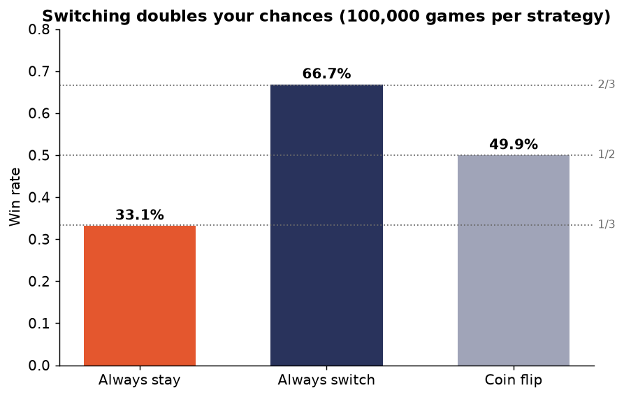
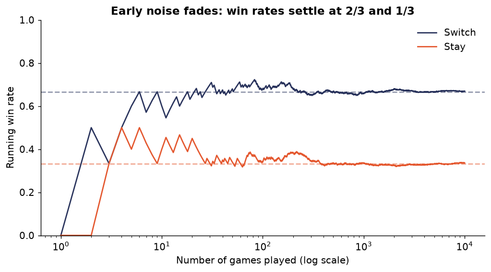
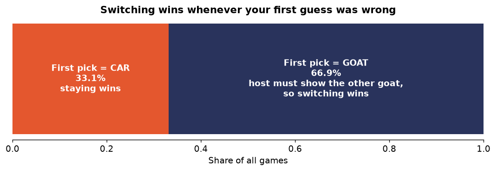
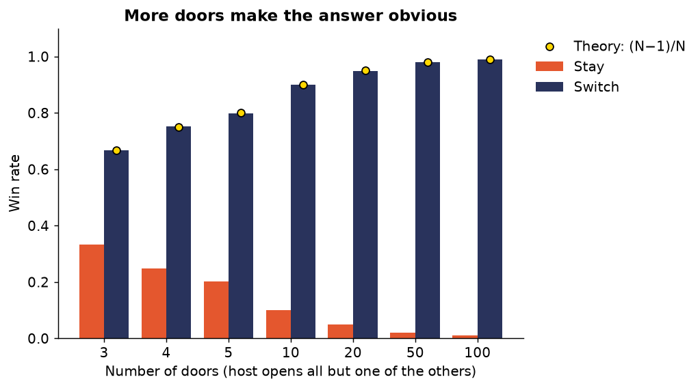
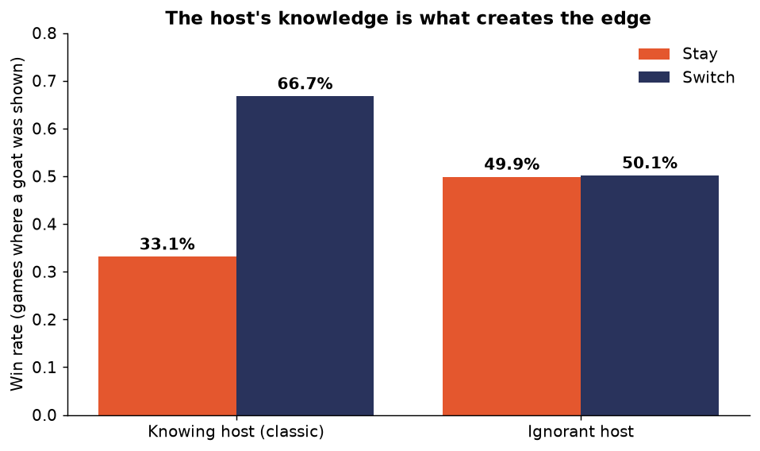
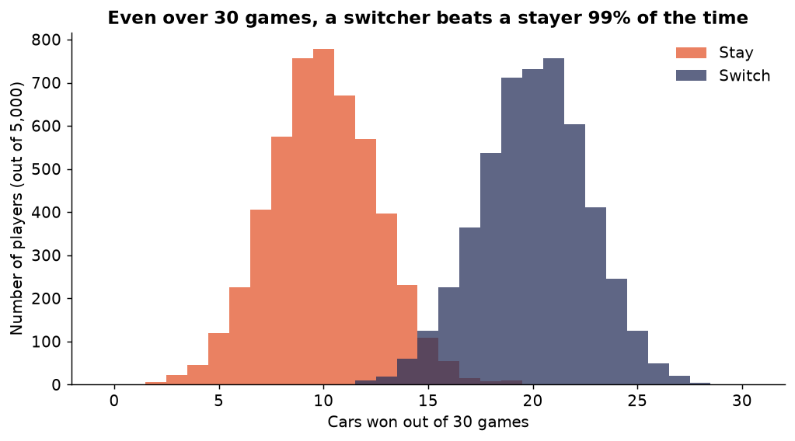

# The Monty Hall Problem, Simulated

> **TL;DR:** If you always switch doors, you win about **2 out of 3** times. If you always stay, you win about **1 out of 3** times. This repo proves it with 1M+ simulated games, six experiments, and charts you can regenerate yourself in about 10 seconds.



---

## Table of Contents
1. [The Problem](#1-the-problem)
2. [Quick Start: Run It Yourself](#2-quick-start-run-it-yourself)
3. [The Experiments](#3-the-experiments)
   - [Exp 1: Stay vs Switch vs Coin Flip](#exp-1-stay-vs-switch-vs-coin-flip)
   - [Exp 2: Watching the Odds Converge](#exp-2-watching-the-odds-converge)
   - [Exp 3: Why Switching Works](#exp-3-why-switching-works)
   - [Exp 4: The 100-Door Version](#exp-4-the-100-door-version)
   - [Exp 5: What If Monty Doesn't Know?](#exp-5-what-if-monty-doesnt-know)
   - [Exp 6: Does It Matter in Real Life?](#exp-6-does-it-matter-in-real-life)
4. [The Math](#4-the-math)
5. [How the Code Works](#5-how-the-code-works)
6. [Repo Structure](#6-repo-structure)

---

## 1. The Problem

You're on a game show with **three doors**. Behind one is a **car** 🚗. Behind the other two are **goats** 🐐.

1. You pick a door, say **Door 1**.
2. The host, Monty, **knows where the car is**. He opens one of the *other* doors, which **always shows a goat**, say **Door 3**.
3. He asks: *"Do you want to stay with Door 1, or switch to Door 2?"*

**Most people say it doesn't matter, since two doors are left and it looks like 50/50.**

**That's wrong.** Switching wins 2/3 of the time. When Marilyn vos Savant published this answer in 1990, thousands of readers wrote in to say she was wrong, including many PhDs. So instead of arguing, let's simulate it.

---

## 2. Quick Start: Run It Yourself

**Requirements:** Python 3.9+

```bash
# 1. Clone the repo
git clone https://github.com/UmairSiddiqui05/monty-hall-simulation.git
cd monty-hall-simulation

# 2. (Optional) Create a virtual environment
python -m venv .venv
source .venv/bin/activate          # Windows: .venv\Scripts\activate

# 3. Install dependencies
pip install -r requirements.txt

# 4. Run all six experiments (regenerates data/ and figures/)
python src/run_experiments.py

# 5. (Optional) Run the tests
pytest -q
```

**Customize the run:**
```bash
python src/run_experiments.py --games 1000000   # 1M games per strategy
python src/run_experiments.py --seed 7          # different random seed
```

Results are reproducible. The same seed always gives the same numbers. Default output is saved in [`results.txt`](results.txt).

---

## 3. The Experiments

All numbers below come from the default run: **100,000 games per strategy, seed 42.**

### Exp 1: Stay vs Switch vs Coin Flip

Three players each play 100,000 games:
- **Stayer:** always keeps their first door
- **Switcher:** always switches
- **Coin-flipper:** randomly stays or switches after the reveal


| Strategy | Wins | Win Rate | Theory |
|---|---|---|---|
| Always stay | 33,120 | **33.1%** | 1/3 |
| Always switch | 66,740 | **66.7%** | 2/3 |
| Coin flip | 49,912 | **49.9%** | 1/2 |

**Takeaway:** Switching **doubles** your chances. Notice the coin-flipper gets 50%. The "it's 50/50" intuition describes someone who picks between the two remaining doors *at random*, not someone using the best strategy.

📄 Data: [`data/01_head_to_head.csv`](data/01_head_to_head.csv)

---

### Exp 2: Watching the Odds Converge

Does switching win right away? Not necessarily. Luck dominates the first few games. This chart tracks the running win rate over 10,000 games.



**Takeaway:** Over the first ~50 games the lines wander, and anyone who only plays a handful of times could reach the wrong conclusion. After a few hundred games, the **law of large numbers** takes over and the lines lock onto **2/3** and **1/3**.

📄 Data: [`data/02_convergence.csv`](data/02_convergence.csv)

---

### Exp 3: Why Switching Works

This is the key insight. **Switching wins exactly when your first pick was wrong.**



Think about the two cases:

| Your first pick was... | How often | What Monty does | Stay | Switch |
|---|---|---|---|---|
| 🚗 The car | 33.1% | Opens either goat door (his choice) | ✅ Win | ❌ Lose |
| 🐐 A goat | 66.9% | **Forced** to open the *other* goat door, so the remaining door **must** be the car | ❌ Lose | ✅ Win |

Your first pick is wrong 2/3 of the time. In every one of those cases, Monty's reveal points you straight to the car. **Switching turns your 2/3 chance of being wrong into a 2/3 chance of winning.**

📄 Data: [`data/03_outcome_breakdown.csv`](data/03_outcome_breakdown.csv)

---

### Exp 4: The 100-Door Version

Still not convinced? Scale it up. Imagine **100 doors**. You pick one. Monty opens **98 goat doors** and leaves just one other door closed.

Would you stick with your original 1-in-100 guess?



| Doors | Stay | Switch | Theory (switch) |
|---|---|---|---|
| 3 | 33.2% | 66.8% | 66.7% |
| 4 | 24.8% | 75.2% | 75.0% |
| 5 | 20.1% | 79.9% | 80.0% |
| 10 | 10.0% | 90.0% | 90.0% |
| 20 | 5.0% | 95.0% | 95.0% |
| 50 | 2.0% | 98.0% | 98.0% |
| 100 | **1.0%** | **99.0%** | 99.0% |

**Takeaway:** With N doors, staying wins **1/N** and switching wins **(N−1)/N**. The 3-door game is the same logic, just less obvious. Monty carefully *avoided* one door out of 99. That door is almost certainly the car.

📄 Data: [`data/04_n_doors.csv`](data/04_n_doors.csv)

---

### Exp 5: What If Monty Doesn't Know?

Here's the twist that shows **why** it works. What if Monty opens a door **at random**, not knowing where the car is? Sometimes he accidentally reveals the car, and we throw those games out. We only keep games where he happened to show a goat.



| Host | Stay | Switch |
|---|---|---|
| Knowing host (classic) | 33.1% | 66.7% |
| Ignorant host | **49.9%** | **50.1%** |

**Takeaway:** When Monty is guessing, it really **is** 50/50. The advantage comes entirely from Monty's **knowledge**. A knowing host is *forced* to avoid the car, and that constraint leaks information about where the car is. A random host's reveal tells you nothing extra.

The two scenarios look the same (a goat behind an opened door), but **the process that produced the reveal changes the probabilities.**

📄 Data: [`data/05_ignorant_host.csv`](data/05_ignorant_host.csv)

---

### Exp 6: Does It Matter in Real Life?

Nobody plays 100,000 times. What if you only played **30 games**? This simulates 5,000 people each playing 30 games with each strategy.



**Takeaway:** The two distributions barely overlap. A typical stayer wins ~10 cars and a typical switcher wins ~20. Over just 30 games, **the switcher comes out ahead 99.4% of the time.** The edge isn't just theory. It shows up fast.

📄 Data: [`data/06_short_run_sessions.csv`](data/06_short_run_sessions.csv)

---

## 4. The Math

For readers who want the formal version, here is **Bayes' theorem**.

You pick Door 1, and Monty opens Door 3. Let $C_i$ be "car behind door $i$" and $M_3$ be "Monty opens Door 3."

**How likely is Monty to open Door 3 in each case?**
- Car behind Door 1: he can open 2 or 3, so $P(M_3 \mid C_1) = \tfrac{1}{2}$
- Car behind Door 2: he's **forced** to open 3, so $P(M_3 \mid C_2) = 1$
- Car behind Door 3: he'd never reveal it, so $P(M_3 \mid C_3) = 0$

**Apply Bayes:**

$$
P(C_2 \mid M_3) = \frac{P(M_3 \mid C_2)\,P(C_2)}{\sum_i P(M_3 \mid C_i)\,P(C_i)}
= \frac{1 \cdot \tfrac13}{\tfrac12 \cdot \tfrac13 + 1 \cdot \tfrac13 + 0}
= \frac{\tfrac13}{\tfrac12} = \boxed{\tfrac23}
$$

The simulation's **66.7%** matches the theory's **66.67%**.

---

## 5. How the Code Works

The engine in [`src/monty_hall.py`](src/monty_hall.py) is fully **vectorized with NumPy**. Instead of looping through games one at a time, it simulates all games at once as arrays, so 100,000 games run in milliseconds.

The core logic for the host:

```python
same = car == pick
# You picked a goat -> host is FORCED to open the only other goat
opened[~same] = 3 - car[~same] - pick[~same]      # doors 0+1+2 = 3
# You picked the car -> host picks one of the two goats at random
opened[same] = (pick[same] + rng.integers(1, 3, same.sum())) % 3
```

The door you'd switch to is simply `3 - pick - opened`.

| Function | What it simulates |
|---|---|
| `play_classic(n, strategy)` | Standard 3-door game (`stay` / `switch` / `random`) |
| `play_n_doors(n, doors, strategy)` | N doors, host opens N−2 goats |
| `play_ignorant_host(n, strategy)` | Host opens a random door ("Monty Fall") |
| `host_opens(car, pick, rng)` | The knowing host's decision rule |

**Tests** in [`tests/test_monty_hall.py`](tests/test_monty_hall.py) check that every simulated rate lands within 1% of theory and that the host never reveals the car or your pick.

---

## 6. Repo Structure

```
monty-hall-simulation/
├── README.md                 ← you are here
├── requirements.txt
├── results.txt               ← console output from the default run
├── src/
│   ├── monty_hall.py         ← simulation engine
│   └── run_experiments.py    ← runs all 6 experiments, saves data + charts
├── tests/
│   └── test_monty_hall.py    ← correctness checks (pytest)
├── data/                     ← raw CSV results for every experiment
│   ├── 01_head_to_head.csv
│   ├── 02_convergence.csv
│   ├── 03_outcome_breakdown.csv
│   ├── 04_n_doors.csv
│   ├── 05_ignorant_host.csv
│   └── 06_short_run_sessions.csv
└── figures/                  ← charts used in this README
    ├── 01_head_to_head.png
    ├── ...
    └── 06_short_run_variance.png
```

---

## Key Takeaways

1. **Always switch.** It wins 2/3 of the time.
2. **Your first pick is probably wrong** (2/3 of the time), and switching exploits that.
3. **Monty's knowledge is the whole trick.** If he's guessing, it's truly 50/50.
4. **Scaling up to 100 doors** makes the intuition obvious.
5. **Simulation beats intuition.** When your gut and the math disagree, run the experiment.

---

## License

[MIT](LICENSE) © 2026 Umair Siddiqui
